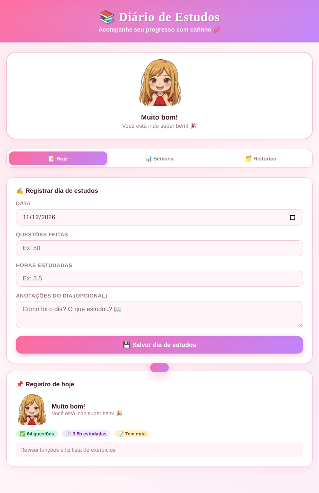
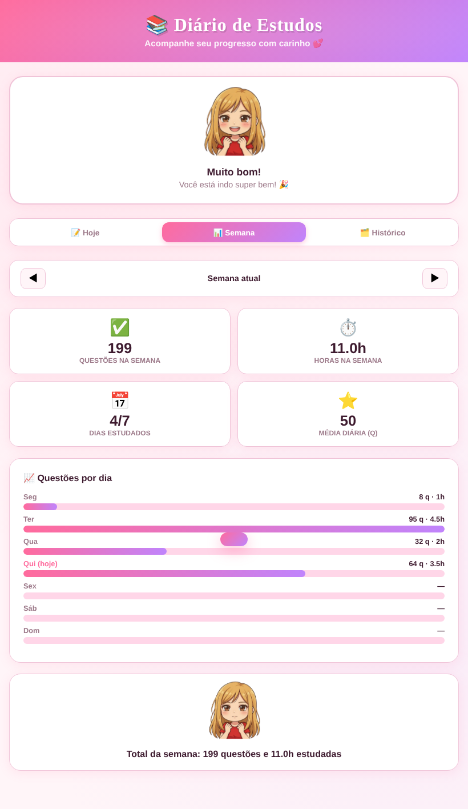
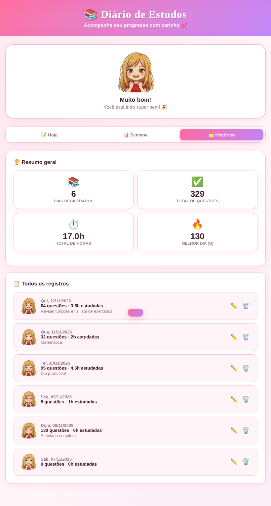

# 📚 ChibiGI — Diário de Estudos

Aplicação web para registrar o dia de estudos (questões feitas, horas e anotações) e acompanhar a evolução pela semana. Uma personagem chibi reage ao desempenho de cada dia.

**Demo:** _https://chibigi.netlify.app/_

| Hoje | Semana | Histórico |
|---|---|---|
|  |  |  |

## Funcionalidades

- **Registro diário:** data, questões, horas e anotações, com aviso ao tentar sobrescrever um dia já registrado.
- **Humor da personagem:** a imagem e a mensagem mudam conforme o número de questões (5 expressões).
- **Visão semanal:** totais de questões e horas, dias estudados, média diária e gráfico de barras por dia, com navegação entre semanas.
- **Histórico:** lista de todos os registros, com edição em modal e exclusão com confirmação.
- **Sem back-end:** os dados ficam no `localStorage` do navegador.

## Tecnologias

HTML5, CSS3 (variáveis CSS, Grid, Flexbox, animações) e JavaScript puro (DOM, `localStorage`, template literals). Sem frameworks nem bibliotecas.

## Como rodar

Não precisa instalar nada: abra o `index.html` no navegador.

## Detalhes de implementação

- Datas calculadas no fuso local (evita o erro de `toISOString()`, que muda o dia depois das 21h no Brasil).
- Anotações escapadas antes de entrar no HTML, para evitar injeção de código.
- Fechamento do modal por clique fora ou tecla Esc.
